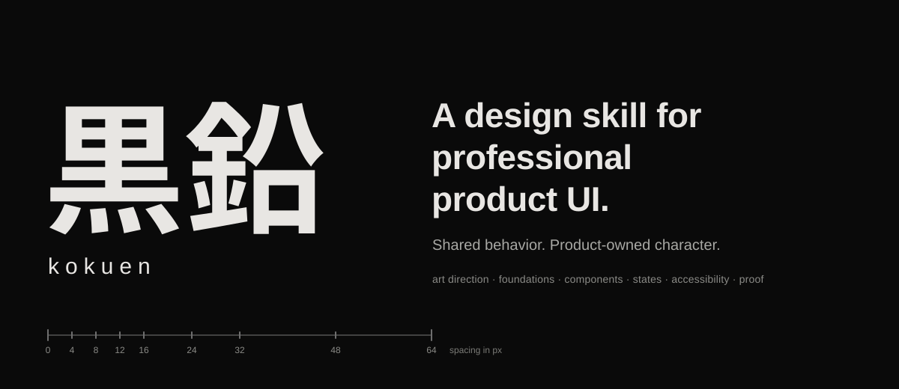

# KOKUEN

A reusable, product-neutral UI template for the parts every app needs: foundations, buttons, fields,
selection, lists, dialogs, feedback, and universal command/search.

It is deliberately not a palette doctrine. Choose a visual direction per product, then keep the
shared UI behavior and spacing coherent.

## What is included

- [`SKILL.md`](SKILL.md): the Codex workflow for applying KOKUEN.
- [`reference.md`](reference.md): component, accessibility, command, Figma, and verification contracts.
- [`kokuen.css`](kokuen.css): a no-build semantic CSS baseline.
- [`preview.html`](preview.html): an interactive component lab.
- [`docs/CUSTOM_THEME.md`](docs/CUSTOM_THEME.md): professional custom-theme brief and theme review.
- [`tokens/kokuen.tokens.json`](tokens/kokuen.tokens.json): DTCG-aligned starter tokens.
- [`scripts/validate_theme.py`](scripts/validate_theme.py): token/alias validation.
- [`docs/KOKUEN_V3_BRIEF.md`](docs/KOKUEN_V3_BRIEF.md): historical v3 scope and component inventory.

## Use it

```html
<link rel="stylesheet" href="kokuen.css">

<button class="ui-button ui-button--primary">Save changes</button>
<input class="ui-field" aria-label="Search notes" placeholder="Search notes, tasks, and commands">
```

Set semantic project tokens once:

```css
:root {
  --ui-canvas: #f7f6f2;
  --ui-surface: #ffffff;
  --ui-text: #1d1c1a;
  --ui-muted: #6e6b66;
  --ui-border: #d9d5ce;
  --ui-focus: #1d1c1a;
  --ui-error: #b42318;
}
```

Open `preview.html` in a browser to test the command dialog, Arrow/Home/End navigation, Escape
focus restoration, selection controls, and slider keyboard behavior.

## Create a custom theme

Start with [`docs/CUSTOM_THEME.md`](docs/CUSTOM_THEME.md), then replace the starter values in
`tokens/kokuen.tokens.json` with product decisions. Preserve the primitive → semantic → component
token ladder and validate aliases before handing it off:

```sh
python3 scripts/validate_theme.py tokens/kokuen.tokens.json
```

## Figma

[Open the KOKUEN Figma library](https://www.figma.com/design/dMpK3ZOhraefh9L6m4BgBi). It contains
the starter foundations, Button variants, Field variants, Universal Command, and the Alles home
screen direction. The current Figma Starter plan has reached its MCP write quota, so the command-open
screen state will be added when that quota resets or the file is upgraded.

MIT.
